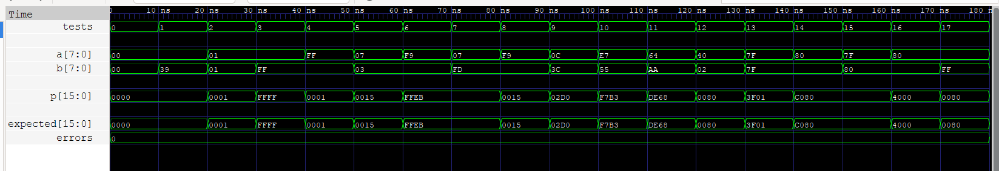
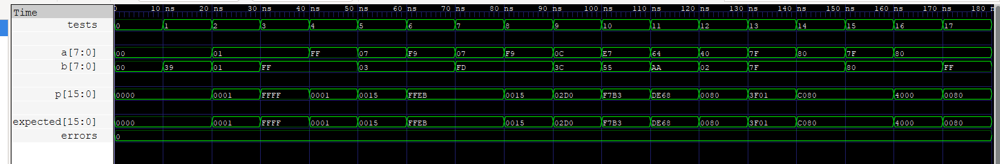

# Booth Multipliers (Radix-2 and Radix-4)

Parameterized, combinational, signed (two's complement) Booth multipliers in Verilog-2001, with directed and self-checking testbenches.

| Design | File | Partial products | Recoded digit set |
| --- | --- | --- | --- |
| Radix-2 Booth | [booth_radix2.v](booth_radix2.v) | `N` | {-1, 0, +1} |
| Radix-4 (Modified) Booth | [booth_radix4.v](booth_radix4.v) | `ceil(N/2)` | {-2, -1, 0, +1, +2} |

Both compute `P = A * B` for `N`-bit signed operands, producing a `2N`-bit signed product. `N` can be any value of 2 or more, odd or even.

## Repository layout

```
booth_radix2.v               Radix-2 Booth multiplier (encoder, PP generator, top)
booth_radix4.v               Radix-4 Booth multiplier (encoder, PP generator, top)
tb_booth_radix2_directed.v   18 hand-picked cases, dumps VCD for waveform viewing
tb_booth_radix2_random.v     Self-checking regression (exhaustive + random)
tb_booth_radix4_directed.v   18 hand-picked cases, dumps VCD for waveform viewing
tb_booth_radix4_random.v     Self-checking regression (exhaustive + random)
booth_radix2.png             Waveform of the radix-2 directed testbench
booth_radix4.png             Waveform of the radix-4 directed testbench
```

## Interface

```verilog
booth_radix2 #(.N(8)) u_mul (.a(a), .b(b), .p(p));   // same ports for booth_radix4
```

| Port | Direction | Width | Description |
| --- | --- | --- | --- |
| `a` | input | `N` (signed) | Multiplicand |
| `b` | input | `N` (signed) | Multiplier |
| `p` | output | `2N` (signed) | Product `a * b` |

| Parameter | Default | Description |
| --- | --- | --- |
| `N` | 8 | Operand width (>= 2) |

## How it works

Each design has three parts:

1. **Booth encoder**: recodes a small window of multiplier bits into a signed digit, as `one` / `two` / `neg` control signals.
2. **Partial product generator**: selects `0`, `A` or `2A` from the sign-extended multiplicand and takes its two's complement (`~x + 1`) when `neg` is set.
3. **Accumulation**: each partial product is shifted to its weight and all of them are summed. The summation is written as a behavioral loop, and synthesis maps it to an adder tree.

### Radix-2

The multiplier is scanned in overlapping 2-bit pairs `{b[i], b[i-1]}`, with `b[-1] = 0`. A run of 1s becomes one subtraction at the start of the run and one addition after it ends. Pair `i` has weight `2^i`.

| b[i] | b[i-1] | Digit | Partial product |
| :-: | :-: | :-: | :-: |
| 0 | 0 | 0 | 0 |
| 0 | 1 | +1 | +A |
| 1 | 0 | -1 | -A |
| 1 | 1 | 0 | 0 |

Encoder logic: `one = b[i] ^ b[i-1]`, `neg = b[i]`.

### Radix-4 (Modified Booth)

The multiplier is scanned in overlapping 3-bit groups `{b[2i+1], b[2i], b[2i-1]}`, with `b[-1] = 0`. Group `i` has weight `4^i`, so the number of partial products is halved. When `N` is odd, the multiplier is sign-extended by one bit to an even width.

| b[2i+1] | b[2i] | b[2i-1] | Digit | Partial product |
| :-: | :-: | :-: | :-: | :-: |
| 0 | 0 | 0 | 0 | 0 |
| 0 | 0 | 1 | +1 | +A |
| 0 | 1 | 0 | +1 | +A |
| 0 | 1 | 1 | +2 | +2A |
| 1 | 0 | 0 | -2 | -2A |
| 1 | 0 | 1 | -1 | -A |
| 1 | 1 | 0 | -1 | -A |
| 1 | 1 | 1 | 0 | 0 |

Encoder logic:

```
one = b[2i] ^ b[2i-1]
two = (b[2i+1] & ~b[2i] & ~b[2i-1]) | (~b[2i+1] & b[2i] & b[2i-1])
neg = b[2i+1]
```

## Simulation

The commands below use [Icarus Verilog](https://steveicarus.github.io/iverilog/) and [GTKWave](https://gtkwave.sourceforge.net/). Any Verilog-2001 simulator works.

### Self-checking regression

```sh
iverilog -o r2 booth_radix2.v tb_booth_radix2_random.v && vvp r2
iverilog -o r4 booth_radix4.v tb_booth_radix4_random.v && vvp r4
```

Each regression covers:

| Width | Vectors |
| --- | --- |
| N = 8 | All 65,536 operand pairs (exhaustive) |
| N = 7 | All 16,384 operand pairs (exhaustive, odd width) |
| N = 16 | 64 corner-case pairs (`0`, `1`, `-1`, `0x7FFF`, `0x8000`, `0x8001`, `0x5555`, `0xAAAA`) plus 100,000 random pairs |

Expected output:

```
PASS: all 181984 tests passed
```

On a failure, the testbench prints the first 10 mismatches and a failure count.

### Directed test and waveforms

```sh
iverilog -o d2 booth_radix2.v tb_booth_radix2_directed.v && vvp d2
gtkwave booth_radix2_directed.vcd
```

This runs 18 cases with N = 8, one every 10 ns: zero and identity, all sign combinations, multiplier bit patterns (runs of 1s, alternating bits, powers of two) and extremes such as `-128 * -128`. It prints a pass/fail table and writes all signals, including DUT internals, to a VCD file. The radix-4 version works the same way with the `radix4` files.

## Results

Both designs pass all 181,984 regression vectors and all 18 directed cases. `errors` stays at 0 in both waveforms.

**Radix-2**



**Radix-4**


